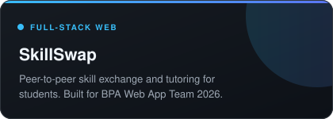
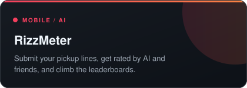
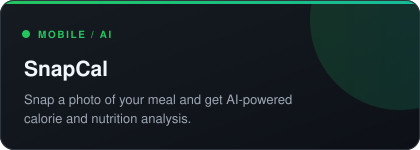



 

[**Portfolio site**](https://rishikpamuru.github.io) &nbsp;·&nbsp; [**Repositories**](https://github.com/Rishikpamuru?tab=repositories) &nbsp;·&nbsp; [**Email**](mailto:rishik.pamuru@gmail.com)

 

## Selected projects

<table>
<tr>
<td align="center"></td>
<td align="center"></td>
</tr>
<tr>
<td align="center"></td>
<td align="center"></td>
</tr>
<tr>
<td align="center"></td>
<td align="center"></td>
</tr>
<tr>
<td align="center"></td>
<td align="center"></td>
</tr>
</table>

## Also in the lab

[Lunar Lander RL](https://github.com/Rishikpamuru/LunarLandingRL) &nbsp;·&nbsp; [Geometry Dash RL](https://github.com/Rishikpamuru/Geomtry-Dash-Rl) &nbsp;·&nbsp; [Plant Disease Detection](https://github.com/Rishikpamuru/Plant-Disease-Detection) &nbsp;·&nbsp; [Sales Prediction](https://github.com/Rishikpamuru/Sales-Pred)

TypeScript · JavaScript · React · React Native · Node.js · Express · Python · PyTorch · Three.js · Prisma
